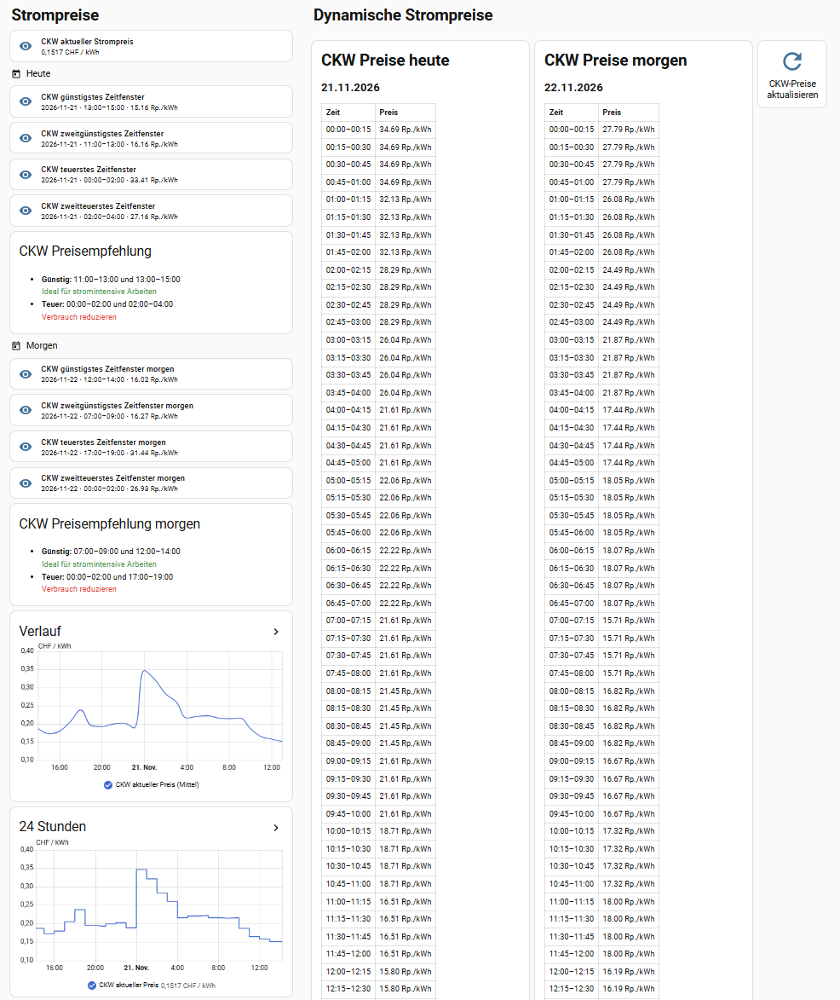

# CKW Dynamische Strompreise für Home Assistant

Dieses öffentliche Teilprojekt ruft dynamische CKW-Tarifdaten ab und zeigt Beispiele für Sensoren, Preisfenster, Empfehlungen und Dashboard-Karten. Es ist ein unabhängiges Community-Beispiel und wird nicht offiziell von CKW oder Home Assistant unterstützt.

Die Dashboard-Vorschau zeigt Beispielwerte vom 22. November 2026. Preise und Zeitfenster ändern sich laufend.

## Inhaltsverzeichnis

- [CKW-Package mit REST-Datenquelle](packages/ckw_tarife.yaml)
- [Einrichtung und Sensor-Helfer](docs/anleitung.md)
- [Auto-Laden-Zeitfenster](docs/auto-laden.md)
- [Dashboard-Karten und Anordnung](docs/dashboard.md)
- [Eigenständiges REST-Beispiel](docs/examples/rest-sensor.yaml)
- [Installation](#installation)

## Installation

Kopiere `packages/ckw_tarife.yaml` in den Ordner `packages/` deiner Home-Assistant-Konfiguration. Stelle sicher, dass deine `configuration.yaml` `packages/` mit `!include_dir_named packages` einbindet. Weitere Sensoren und Helfer stehen in der [Einrichtungsanleitung](docs/anleitung.md), alle Dashboard-Karten in der [Dashboard-Dokumentation](docs/dashboard.md).

Prüfe den Tarifnamen und die tatsächlich erzeugten Entity-IDs deiner Installation. CKW veröffentlicht Preise für den Folgetag erst später am Tag; Beispielwerte in Screenshots sind Momentaufnahmen.
