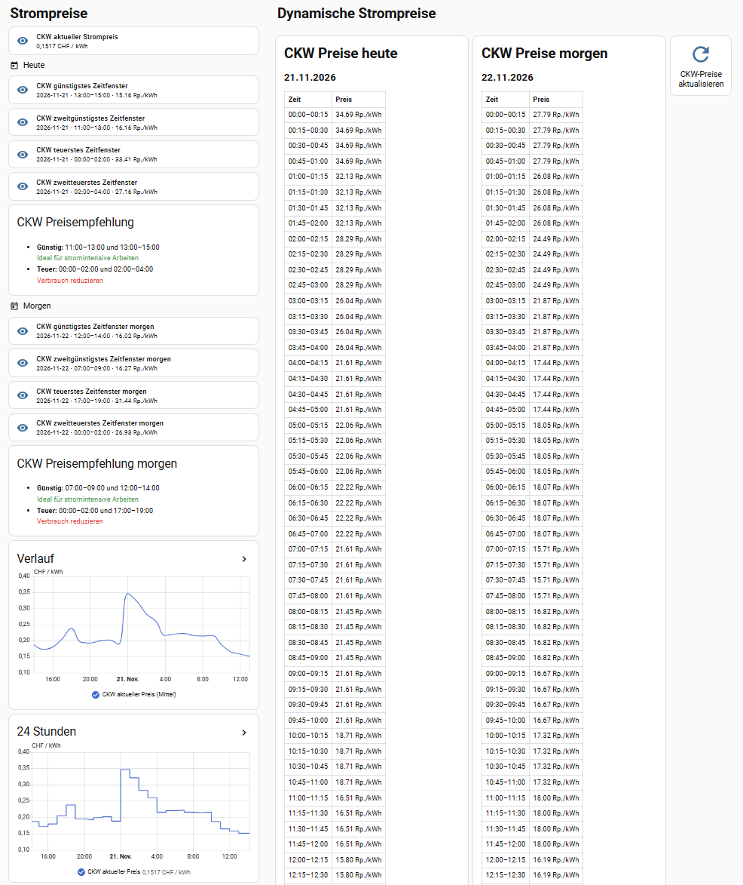

# CKW-Dashboard für Home Assistant

Diese Datei beschreibt das aktuelle CKW-Dashboard und enthält die YAML-Konfigurationen der dargestellten Karten. Die Beispiele verwenden die unten aufgeführten Entity-IDs. Wenn Home Assistant bei dir andere IDs vergeben hat, ersetze sie durch die tatsächlichen IDs deiner Entitäten.

Zum Einstieg: [1. CKW-Package einbinden](anleitung.md#1-ckw-package-einbinden) und Sensoren einrichten. Die Auto-Laden-Helfer stehen in [Auto-Laden-Zeitfenster](auto-laden.md). Diese Datei ist die zentrale Referenz für sämtliche Dashboard-Karten und ihre Anordnung.

## Inhaltsverzeichnis

- [Dashboard-Aufbau](#dashboard-aufbau)
- [Aktuelle Dashboard-Vorschau](#aktuelle-dashboard-vorschau)
- [Verwendete Entitäten](#verwendete-entitäten)
- [Strompreis-Karten](#strompreis-karten)
  - [Aktueller Preis](#aktueller-preis)
  - [Auto-Laden-Zeitfenster](#auto-laden-zeitfenster)
  - [Vier Zeitfenster für heute](#vier-zeitfenster-für-heute)
  - [Preisempfehlung für heute](#preisempfehlung-für-heute)
  - [Vier Zeitfenster für morgen](#vier-zeitfenster-für-morgen)
  - [Preisempfehlung für morgen](#preisempfehlung-für-morgen)
  - [Preisverlauf](#preisverlauf)
- [Dynamische Strompreis-Karten](#dynamische-strompreis-karten)
  - [CKW Preise heute](#ckw-preise-heute)
  - [CKW Preise morgen](#ckw-preise-morgen)
  - [CKW-Preise aktualisieren](#ckw-preise-aktualisieren)
- [Karten im Dashboard anordnen](#karten-im-dashboard-anordnen)
- [Hinweise](#hinweise)

## Dashboard-Aufbau

Das Dashboard ist in zwei Bereiche gegliedert:

### Strompreise

1. Aktueller CKW-Strompreis und die 5-Stunden-Fenster **Auto laden** und **Auto laden gesperrt**.
2. Abschnitt **Heute** mit den vier heutigen 2-Stunden-Zeitfenstern und der heutigen Preisempfehlung.
3. Abschnitt **Morgen** mit den vier morgigen 2-Stunden-Zeitfenstern und der morgigen Preisempfehlung.
4. Eine Verlaufskarte für den aktuellen Preis. Die Vorschau zeigt zusätzlich eine 24-Stunden-Preisansicht.

### Dynamische Strompreise

1. Markdown-Tabelle mit allen 96 Viertelstundenpreisen von heute.
2. Markdown-Tabelle mit allen verfügbaren Preisen von morgen.
3. Button, der den CKW-Sensor sofort erneut abfragt.

Für ein Layout wie im Screenshot platziere die Karten in einer breiten Dashboard-Ansicht: links den Bereich **Strompreise**, rechts **Dynamische Strompreise** mit den beiden Tabellen nebeneinander und dem Aktualisierungsbutton daneben. In der mobilen Ansicht können Karten untereinander angeordnet werden.

### Aktuelle Dashboard-Vorschau



Die Vorschau zeigt Beispielwerte vom 22. November 2026. Preise und Zeitfenster ändern sich mit den veröffentlichten CKW-Tarifdaten.

## Verwendete Entitäten

### CKW-Daten und aktueller Preis

| Anzeige | Entity-ID |
|---|---|
| CKW Tarifdaten | `sensor.ckw_tarifdaten` |
| CKW aktueller Strompreis | `sensor.ckw_aktueller_preis` |

### Auto-Laden-Entitäten

| Anzeige | Entity-ID |
|---|---|
| Auto laden | `sensor.auto_laden` |
| Auto laden gesperrt | `sensor.auto_laden_gesperrt` |

Die Template-Helfer werden in der [Auto-Laden-Anleitung](auto-laden.md) erstellt.

### Zeitfenster heute

| Anzeige | Entity-ID |
|---|---|
| CKW günstigstes Zeitfenster | `sensor.ckw_guenstigstes_zeitfenster_von_2h` |
| CKW zweitgünstigstes Zeitfenster | `sensor.ckw_zweitguenstigstes_zeitfenster_von_2h` |
| CKW teuerstes Zeitfenster | `sensor.ckw_teuerstes_zeitfenster_von_2h` |
| CKW zweitteuerstes Zeitfenster | `sensor.ckw_zweitteuerstes_zeitfenster_von_2h` |
| CKW Preisempfehlung | `sensor.ckw_preisempfehlung` |

### Zeitfenster morgen

| Anzeige | Entity-ID |
|---|---|
| CKW günstigstes Zeitfenster morgen | `sensor.ckw_guenstigstes_zeitfenster_morgen_von_2h` |
| CKW zweitgünstigstes Zeitfenster morgen | `sensor.ckw_zweitguenstigstes_zeitfenster_morgen_von_2h` |
| CKW teuerstes Zeitfenster morgen | `sensor.ckw_teuerstes_zeitfenster_morgen_von_2h` |
| CKW zweitteuerstes Zeitfenster morgen | `sensor.ckw_zweitteuerstes_zeitfenster_morgen_von_2h` |
| CKW Preisempfehlung morgen | `sensor.ckw_preisempfehlung_morgen` |

## Strompreis-Karten

### Aktueller Preis

```yaml
type: entity
entity: sensor.ckw_aktueller_preis
name: CKW aktueller Strompreis
```

### Auto-Laden-Zeitfenster

```yaml
type: entities
title: Auto-Laden
show_header_toggle: false
entities:
  - entity: sensor.auto_laden
    name: Auto laden
  - entity: sensor.auto_laden_gesperrt
    name: Auto laden gesperrt
```

### Vier Zeitfenster für heute

```yaml
type: entities
title: Heute
show_header_toggle: false
entities:
  - entity: sensor.ckw_guenstigstes_zeitfenster_von_2h
    name: CKW günstigstes Zeitfenster
  - entity: sensor.ckw_zweitguenstigstes_zeitfenster_von_2h
    name: CKW zweitgünstigstes Zeitfenster
  - entity: sensor.ckw_teuerstes_zeitfenster_von_2h
    name: CKW teuerstes Zeitfenster
  - entity: sensor.ckw_zweitteuerstes_zeitfenster_von_2h
    name: CKW zweitteuerstes Zeitfenster
```

### Preisempfehlung für heute

Die Karte liest die Zeitfenster direkt aus den vier Sensoren, sortiert sie chronologisch und zeigt die Hinweise farbig an.

```yaml
type: markdown
title: CKW Preisempfehlung
entity_id:
  - sensor.ckw_guenstigstes_zeitfenster_von_2h
  - sensor.ckw_zweitguenstigstes_zeitfenster_von_2h
  - sensor.ckw_teuerstes_zeitfenster_von_2h
  - sensor.ckw_zweitteuerstes_zeitfenster_von_2h
content: |
  
  
  
  
  
    
    
  - **Günstig:** {{ guenstig | join(' und ') }}<br><font color="#43a047">Ideal für stromintensive Arbeiten</font>
  - **Teuer:** {{ teuer | join(' und ') }}<br><font color="#e53935">Verbrauch reduzieren</font>
  
  Die Preisempfehlung für heute ist derzeit nicht verfügbar.
  
```

### Vier Zeitfenster für morgen

```yaml
type: entities
title: Morgen
show_header_toggle: false
entities:
  - entity: sensor.ckw_guenstigstes_zeitfenster_morgen_von_2h
    name: CKW günstigstes Zeitfenster morgen
  - entity: sensor.ckw_zweitguenstigstes_zeitfenster_morgen_von_2h
    name: CKW zweitgünstigstes Zeitfenster morgen
  - entity: sensor.ckw_teuerstes_zeitfenster_morgen_von_2h
    name: CKW teuerstes Zeitfenster morgen
  - entity: sensor.ckw_zweitteuerstes_zeitfenster_morgen_von_2h
    name: CKW zweitteuerstes Zeitfenster morgen
```

### Preisempfehlung für morgen

```yaml
type: markdown
title: CKW Preisempfehlung morgen
entity_id:
  - sensor.ckw_guenstigstes_zeitfenster_morgen_von_2h
  - sensor.ckw_zweitguenstigstes_zeitfenster_morgen_von_2h
  - sensor.ckw_teuerstes_zeitfenster_morgen_von_2h
  - sensor.ckw_zweitteuerstes_zeitfenster_morgen_von_2h
content: |
  
  
  
  
  
    
    
  - **Günstig:** {{ guenstig | join(' und ') }}<br><font color="#43a047">Ideal für stromintensive Arbeiten</font>
  - **Teuer:** {{ teuer | join(' und ') }}<br><font color="#e53935">Verbrauch reduzieren</font>
  
  Die Preisempfehlung für morgen ist derzeit nicht verfügbar.
  
```

### Preisverlauf

Diese Verlaufskarte zeigt den aktuellen CKW-Preis über die letzten 24 Stunden. Weitere Optionen stehen in der [offiziellen Home-Assistant-Dokumentation](https://www.home-assistant.io/dashboards/history-graph/).

```yaml
type: history-graph
title: Verlauf
hours_to_show: 24
entities:
  - entity: sensor.ckw_aktueller_preis
    name: CKW aktueller Preis
```

## Dynamische Strompreis-Karten

Die Tabellen lesen die `prices`-Daten direkt aus `sensor.ckw_tarifdaten`. Preise werden mit zwei Dezimalstellen in Rp./kWh ausgegeben.

### CKW Preise heute

```yaml
type: markdown
content: |
  
  {% set tag = datum.strftime('%Y-%m-%d') %}
  
  
  
    
      
      {% set rp = '%.2f' | format((p.integrated[0].value | float(0)) * 100) %}
      
    
  
  # CKW Preise heute
  ## {{ datum.strftime('%d.%m.%Y') }}

  | Zeit | Preis |
  |:---|---:|
  {{ ns.zeilen | join('\n') }}
```

### CKW Preise morgen

```yaml
type: markdown
content: |
  
  {% set tag = datum.strftime('%Y-%m-%d') %}
  
  
  
    
      
      {% set rp = '%.2f' | format((p.integrated[0].value | float(0)) * 100) %}
      
    
  
  # CKW Preise morgen
  ## {{ datum.strftime('%d.%m.%Y') }}

  | Zeit | Preis |
  |:---|---:|
  {{ ns.zeilen | join('\n') }}
```

### CKW-Preise aktualisieren

Der Button löst eine sofortige Aktualisierung von `sensor.ckw_tarifdaten` aus. Er ändert das normale Abrufintervall nicht.

```yaml
type: button
name: CKW-Preise aktualisieren
icon: mdi:refresh
show_state: false
tap_action:
  action: perform-action
  perform_action: homeassistant.update_entity
  data:
    entity_id: sensor.ckw_tarifdaten
```

## Karten im Dashboard anordnen

1. Dashboard bearbeiten und zwei breite Bereiche oder Spalten anlegen: **Strompreise** und **Dynamische Strompreise**.
2. Im Bereich **Strompreise** die Karten in dieser Reihenfolge hinzufügen: aktueller Preis, Auto-Laden-Zeitfenster, heutige Zeitfenster und Empfehlung, morgige Zeitfenster und Empfehlung, Preisverlauf.
3. Im Bereich **Dynamische Strompreise** die beiden Markdown-Tabellen nebeneinander platzieren und den Aktualisierungsbutton rechts daneben setzen.
4. Für jede Karte den vollständigen YAML-Block in den YAML-Editor der Karte einfügen.

Home Assistant kann bei kleinen Displays oder schmalen Abschnitten Karten untereinander stapeln. Die Reihenfolge bleibt dabei erhalten.

## Hinweise

- Die Zeitfenster-Sensoren müssen zuerst als Template-Sensor-Helfer eingerichtet sein. Die Entity-IDs in diesem Dokument entsprechen dem hier verwendeten Beispiel.
- CKW muss die Preise für morgen bereits veröffentlicht haben. Bis dahin können morgige Tabelle und Morgen-Sensoren leer oder nicht verfügbar sein.
- Die beiden Preisempfehlungskarten greifen auf die vier jeweiligen Zeitfenster-Sensoren zu. Wenn einer davon `unknown` oder `unavailable` ist, zeigt die Karte einen Verfügbarkeitshinweis.
- Der Button aktualisiert nur `sensor.ckw_tarifdaten`; Preise werden angezeigt, wenn CKW sie zurückliefert.
- Die Vorschau zeigt zusätzlich eine 24-Stunden-Preisansicht. Dafür ist in der jeweiligen Home-Assistant-Konfiguration eine passende Preisreihen-Entität nötig; dieses Projekt stellt dafür keinen separaten Sensor bereit.
